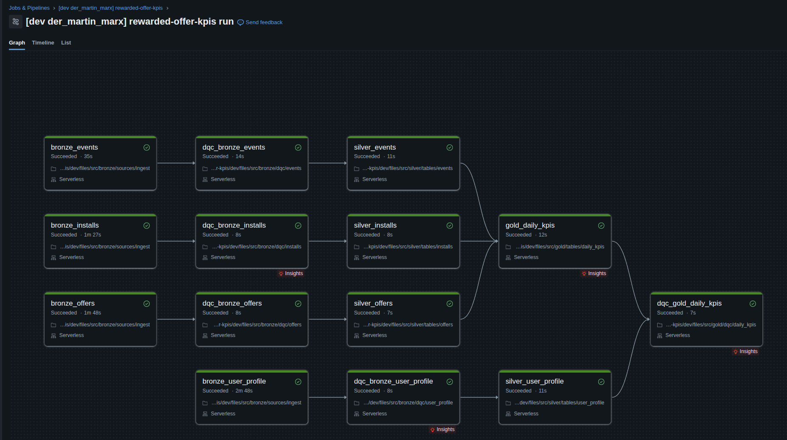
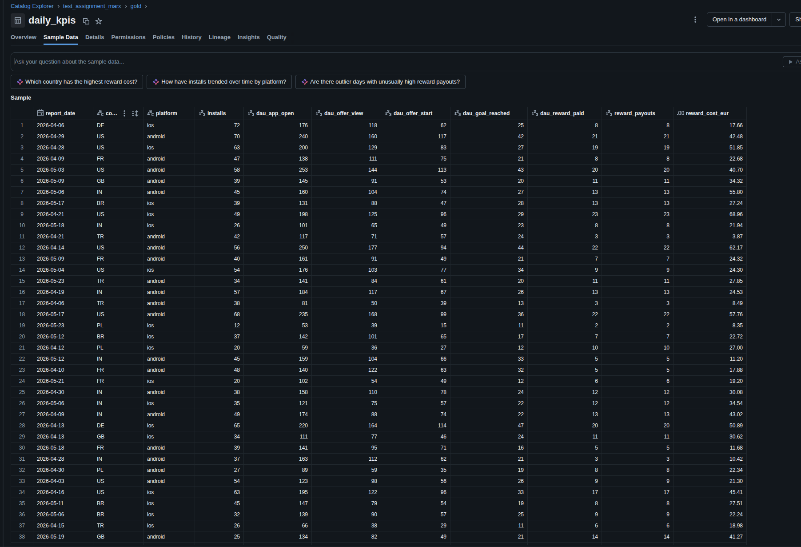

# Solution Write-Up

## Environment, How to Run & Verify

* **Environment:** Databricks Free Edition (Serverless compute + Unity Catalog). Free Edition covers serverless notebooks, Workflows, and UC Volumes out of the box, while constraining custom cluster tuning and always-on streaming—which aligns naturally with a scheduled batch architecture.
* **Setup & Run:**
  1. Execute the DDL setup script against a UC-enabled SQL Warehouse to create the `test_assignment_marx` catalog, schemas (`bronze`, `silver`, `gold`, `data`), and volume `raw_data`, then upload the four CSVs into `/Volumes/test_assignment_marx/data/raw_data/`.
  2. Deploy and trigger the workflow via Databricks CLI:
     ```bash
     databricks bundle deploy
     databricks bundle run <job_name>
     ```
  3. Run unit tests locally:
     ```bash
     pytest
     ```
* **Verification:**
  * Confirm all DQC tasks pass without raising `ValueError`.
  * Query Gold and reconcile `installs` / `reward_payouts` totals against `silver.installs` and `silver.fact_events`:
    ```sql
    SELECT * FROM test_assignment_marx.gold.daily_kpis
    ORDER BY report_date DESC, country, platform
    LIMIT 10;
    ```
  *(Note: Paste 3–5 rows of your actual `gold.daily_kpis` query output here before packaging the submission.)*

---

## 1. Three-Layer Architecture (Bronze, Silver, Gold)

* **Bronze:** Stores raw snapshots loaded directly from source files (all columns as `STRING` to preserve raw payloads).
* **Silver:** Cleaned, typed, and deduplicated tables built from Bronze:
  * **`fact_events`:** Incrementally loaded using `ingest_ts`. Designed for high-volume event streams where source retries/duplicates are expected, while conflicting payloads for the same `event_id` are treated as data quality errors.
  * **`installs`:** Overwritten from the latest snapshot and deduplicated by `user_id` to keep the dimension simple.
  * **`offers`:** Deduplicated overwrite clustered on offer_id. Cost: No historical attribute changes are tracked.
  * **`user_profile`:** Implemented as SCD Type 2 over the 30-day backend profile snapshot, used downstream for DQC reconciliation against telemetry.
* **Gold (`daily_kpis`):** Recomputes the last 7 days (`lookback_days = 7`) on each run to absorb late-arriving events—chosen because 7 days covers the maximum lag between `event_ts` and `ingest_ts` observed in the dataset.

---

## 2. Making the Pipeline Re-Runnable (Idempotency & Trade-offs)

* **Bronze:** Full overwrite on every run.
  * *Cost:* No raw historical snapshots are retained beyond Delta Time Travel.
* **Silver:**
  * **`fact_events`:** Upserted (`MERGE`) by `event_id` (using date/key clustering to bound merge scans), filtering out rows with `ingest_ts` older than the current watermark while allowing `event_ts` updates. *Cost:* Out-of-order rows with older `ingest_ts` are skipped.
  * **`installs`:** Deduplicated overwrite clustered on `install_date`. *Cost:* No historical attribute changes are tracked.
  * **`offers`:** Deduplicated overwrite clustered on offer_id. Cost: No historical attribute changes are tracked.
  * **`user_profile`:** SCD Type 2 (`valid_from`, `valid_to`, `is_current`) tracks full attribute change history over time.
* **Gold (`daily_kpis`):** Atomically replaces only the last 7 days via `replaceWhere` instead of reprocessing the full table, ensuring idempotent recalculation of non-additive `COUNT(DISTINCT user_id)` metrics as late events arrive.
  * *Cost:* Recomputes full days across the 7-day window on every run rather than updating individual rows.

---

## 3. Deciding What Is Trustworthy (Data Quality Strategy)

Each Bronze table runs a dedicated DQC task before loading Silver, followed by a final DQC task after Gold and `user_profile` complete.

**Blocking checks (raise `ValueError` and halt downstream tasks):**
* **Duplicate business keys** in reference/entity snapshots (`installs`, `offers`, `user_profile`) — prevents ambiguous joins and fan-out.
* **Mutations of immutable records** (conflicting payloads or attributes for an existing `event_id`, `user_id` in `installs`, or `offer_id`) — stops silent corruption of historical facts.
* **Negative `payout_eur` values** — invalid financial amounts are blocked in DQC and enforced at the storage layer via `CHECK (payout_eur >= 0)`.
* **Orphan payouts** (`reward_paid` events referencing an `offer_id` missing from `silver.offers`) — enforced in post-Gold DQC to prevent unpriced payouts.

**Non-blocking audits (log `DATA_QUALITY_ALERT` and continue):**
* **Blank required identifiers & unparseable timestamps:** Retained as-is in Bronze for auditability, dropped before loading Silver.
* **Raw duplicate `event_id`s (identical payload):** Kept in Bronze; collapsed in Silver by keeping the earliest `ingest_ts`.
* **Unknown `event_name` values:** Kept as-is in Silver so unexpected event types are not silently lost, while logging an alert.
* **Events arriving beyond `lookback_days`:** Logged so late tails outside the 7-day Gold window are visible.
* **Cross-source reconciliation gaps:** Profiles in `silver.user_profile` reporting `events_lifetime > 0` with no matching telemetry in `silver.fact_events` are flagged without breaking the pipeline.

---

## 4. Tests

* **Thin notebooks, testable modules:** Notebooks only handle high-level DataFrame orchestration; all transformation logic lives in util PySpark functions.
* **Unit tests:** Cover core transformation scenarios—aggregations, join behaviors (including `full` and `left` joins), deduplication, and edge cases—and fail on breaking logic changes.
* **Storage constraint:** Enforced `CHECK (payout_eur >= 0)` directly in DDL on `silver.offers` as a database-level guardrail.

---

## The Deeper Questions

### The daily job

**What gets wrong:**
Filtering Silver by `MAX(ingest_ts)` over a single overwritten raw file silently drops rows whenever clock skew or delayed exports produce older `ingest_ts` values. Overwriting one unpartitioned file also wipes raw batch history and forces full-table DQC scans on every run.

**How to find out:**
In the current setup, you don't—skipped rows vanish silently until downstream users report missing numbers.

**What to build instead:**
* **Partitioned raw history + file tracking:** Keep raw history instead of overwriting a single file—store immutable incoming files partitioned by landing date (or append updated dumps with our own landing timestamp), and track processed files (via a manifest or Auto Loader) rather than relying on payload `ingest_ts`.
* **Batch-scoped DQC:** Run stateless checks on new files only so old alerts don't re-fire, while keeping global `event_id` deduplication against Silver.
* **Recalculate only changed dates in Gold:** Extract the distinct `event_date`s touched by the new batch and recompute only those full days via `replaceWhere`—capturing the 2.51% of events arriving >24h late (tail up to 133.9h) without blindly recalculating a fixed date range every night.

### Your platform choices

* **Gold `replaceWhere`:** In Gold, full-day atomic `replaceWhere` keeps non-additive `COUNT(DISTINCT user_id)` exact and SQL stateless (since a mixed `(report_date, country, platform)` row cannot be updated by simply merging additive deltas like `installs` or `reward_payouts`), trading higher compute against file-routed partial rewrites or approximate HyperLogLog sketches.
* **Liquid Clustering:** Chose `CLUSTER BY (report_date, country, platform)` in Gold (`CLUSTER BY` on date/lookup keys in Silver) to avoid tiny files from 3-column partitioning while keeping multi-column data skipping—trading weaker single-date rewrite isolation than `PARTITIONED BY`. Verify in **Spark UI → SQL / DataFrame** (`Scan` node: `number of files read` vs `files pruned`).
* **Ingestion pattern:** Scheduled `MAX(ingest_ts)` batching avoids streaming overhead, but breaks on out-of-order exports and full-table DQC scans (see *The daily job*), where immutable raw files and file-based tracking must replace it. More details in the previous in depth question
* **Unity Catalog:** This part is not covered by the tech assignment

## How I Worked with AI

* **Workflow & tool split:** Used Opencode (Terra 5.6) to scaffold the initial project and DABs structure, Claude Haiku 5.5 for targeted code and unit-test refinements, and Gemini to stress-test edge cases and tighten the write-up.
* **Context across sessions:** Instead of relying on long chat histories, I carried context between tools through concrete artifacts—the SQL DDL, pure PySpark transformation modules, and incremental drafts of `SOLUTION.md`.
* **What I kept:** Boilerplate scaffolding, parameterized pytest cases, and structured trade-off framing for non-additive metrics and ingestion failure modes, refining documentation
* **What I rejected:** Repeatedly stripped out over-engineered suggestions and hallucinations invalid suggestion to use `PARTITION BY` + `CLUSTER BY` for a DDL
### Result

